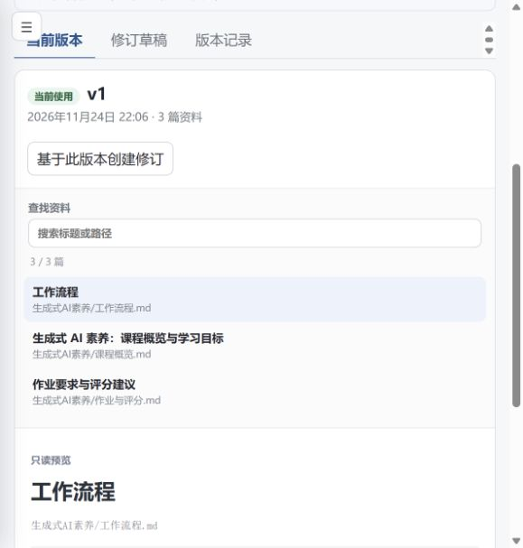
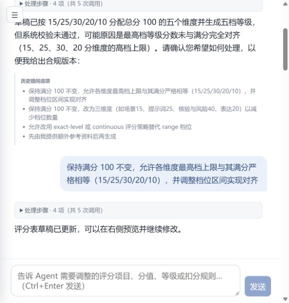
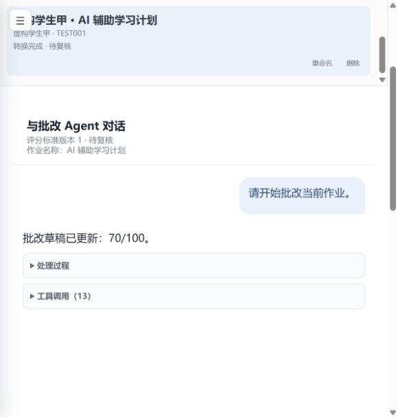
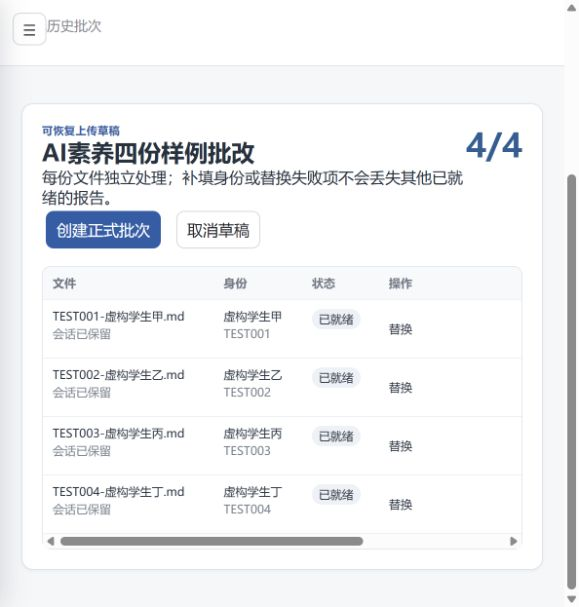
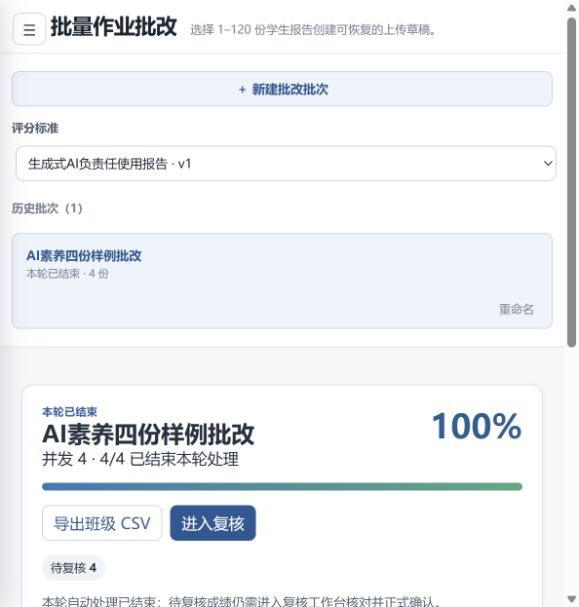

# Course Agent 实际使用说明与体验记录

此页记录首轮观察。后续修复、批次导出入口变化和新场景复测见[真实使用回归记录](../../2026-11-24-real-use-regression.md)。

测试日期：2026-11-24（新加坡时间）

测试环境：本机 `http://localhost:5173/`，浏览器，现有模型配置。

测试数据：全部为虚构课程与学生；模型生成的结论需人工复核。本记录不是里程碑用户验收结论。

## 1. 测试素材

- 课程：生成式AI素养（真实使用测试）。
- [课程讲义](课程资料.md)：学习目标、流程、作业要求与建议权重。
- 四份报告：[甲](TEST001-虚构学生甲.md)、[乙](TEST002-虚构学生乙.md)、[丙](TEST003-虚构学生丙.md)、[丁](TEST004-虚构学生丁.md)，分别覆盖较完整、部分完成、内容极少、证据不足。报告中引用仅为合成练习，本次未独立验证外部来源。

## 2. 从建课到发布资料

1. 打开首页，在“课程管理”输入课程名称，点击“新建课程”。成功后当前课程会自动切换。
2. 进入“课程资料库”，点击“导入 Markdown 资料”，选择写好的 `.md` 文件。等待整理；本次一个源文件被拆为三篇。
3. 在“修订草稿”选择篇目，直接编辑 Markdown，点击“保存修改”。本次补充了使用虚构案例和保护个人信息的课堂提示。
4. 点击“发布并启用”，阅读提示后确认。界面显示当前使用 v1、三篇资料；答疑应使用已发布版本。

## 3. 创建评分标准并与 Agent 沟通

1. 打开“评分量表”，填写名称、满分以及作业要求；要求或参考资料至少填写一项。点击下一步。
2. 选择评分制度。本次选择加分制，要求五项权重 15、25、30、20、10，总分 100。
3. Agent 首次生成时提示草稿校验未通过，并提出解决选项。选择保持各维度权重和满分、调整区间，发送后得到五项草稿。
4. 可继续用自然语言咨询或要求修改。测试中进一步进行了三轮咨询：一项主张核验如何评分、区间小数边界、对上一回答的反例追问。咨询完成后界面显示草稿未修改。
5. 检查右侧维度、权重、等级和描述；点击“校验并准备冻结”，通过后点击“确认冻结为正式版本”。本次得到 v1，可用于批改。

**人工检查很重要：** Agent 对区间边界的第二轮回答存在逻辑错误，第三轮没有直接纠正它自己提出的例子，见第 6 节。冻结通过表示程序结构校验通过，并不保证评分文字和模型建议正确。

## 4. 单份批改与复核

1. 进入“单份批改”，选择冻结评分标准，点击“创建批改会话”。填写姓名、学号和可选作业名，选择学生报告，点击“创建会话”。
2. 查看转换后的报告，点击“开始批改”。等待模型生成逐项得分、理由、分析依据与置信度。
3. 对照原文和标准检查结果。若需修正，点击“人工修订评分项”，修改得分或理由并填写人工修订备注，保存后系统重新计算总分。
4. 勾选每项复核提示，填写复核备注，点击“确认并发布正式结果”。确认后可导出 JSON 或 Markdown；后续修改使用结果修订。

本次甲的单份结果为 **70/100**（8+21+22+11+8），显示需教师复核。模型把报告中测试当天的日期当作未来日期，未提供可支持的提交时间依据；测试中修正了该项理由，保留分数并说明来源未独立核验，然后确认正式结果。该分数只用于流程体验，并非质量标定。

## 5. 四份批量批改

1. 进入“批量批改”，选择已冻结评分标准，选择多份报告，设置批次名称和并发数。本次选择四份 Markdown，并发 4。
2. 点击“下一步：上传并准备批次”，等待每份报告转换和识别身份。检查姓名、学号和状态；四项均为“已就绪”后点击“创建正式批次”。
3. 点击“启动批改”。本次四份均完成第一轮处理，并进入待复核，无失败项。
4. 点击学生作业或“进入复核”，对照报告和逐项分析；勾选复核原因、填写备注并确认。实际确认丙后，列表更新为一份已确认、三份待复核。
5. 点击“导出班级 CSV”。本次下载的 CSV 包含四名学生，**既包含已确认，也包含待复核结果**，以“复核状态”区分；不要把整个文件视为已正式确认的成绩。

| 样例 | 批次结果 | 处理状态 |
|---|---:|---|
| 甲 TEST001 | 70/100 | 待复核 |
| 乙 TEST002 | 45/100 | 待复核 |
| 丙 TEST003 | 11.5/100 | 已复核确认 |
| 丁 TEST004 | 41/100 | 待复核 |

单份和批量对同一份甲报告分别得到 70 分；这是一次观察，不能据此推断多次运行稳定一致。批次中的其余三份未进行完整人工评分复核。

## 6. 实际发现与体验建议

1. **Agent 的数学边界解释不可靠。** 它建议“0–1、2–5”等整数边界，同时称任何半分都能落档；1.5 实际不在这两个闭区间内。追问后它解释的是现有草稿的 1–4.99，而没有正面处理自己建议的区间。建议对话中引用具体上文、明确计分精度；重要边界用程序校验或人工计算。
2. **单份结果推断了不存在的时间事实。** 报告日期为测试当天，Agent 却说是未来日期或晚于一般提交时间；界面没有给出支持该判断的提交时间。教师可修订理由，但确认前需要仔细检查事实性论断。
3. **首版生成需要补救。** 选择加分制后首次生成因校验失败未形成草稿，Agent 通过选项让教师处理；第二轮成功。系统有反馈，但一般教师难以判断“最高档上限未对齐”等技术原因，建议给出更具体可操作的校验解释。
4. **批量 CSV 混合状态。** 实测一个已确认、三个待复核时，四行全部导出，状态列区分。建议在导出入口明确提示包含未确认成绩或提供仅导出已确认的选项；当前不应仅凭文件名判断成绩状态。
5. **状态与流程体验。** 上传后逐项显示身份、名称识别和就绪，正式批次与启动分为两步；自动处理结束仍明确提示需复核。确认一份后，复核工作台和批次列表计数同步更新。
6. **版面细节。** 资料草稿预览中，“工作流程”同时作为页面标题与 Markdown 二级标题出现两次；不影响编辑，但可能让教师误以为内容重复。

## 7. 测试范围和未验证事项

本次真实操作了浏览器建课、资料导入和编辑发布、评分 Agent 三轮以上对话、冻结、单份批改与修订确认、四份并发批改、其中一份复核和 CSV 下载。未对四份结果全部做人工评分标定，未检查 JSON/Markdown 导出内容、暂停恢复、重启恢复、PDF/DOCX 转换或引用网页有效性。只记录浏览器截图；其他界面暂不截图。本次未更改产品代码，也不代表 M4/M5 已由用户验收。
